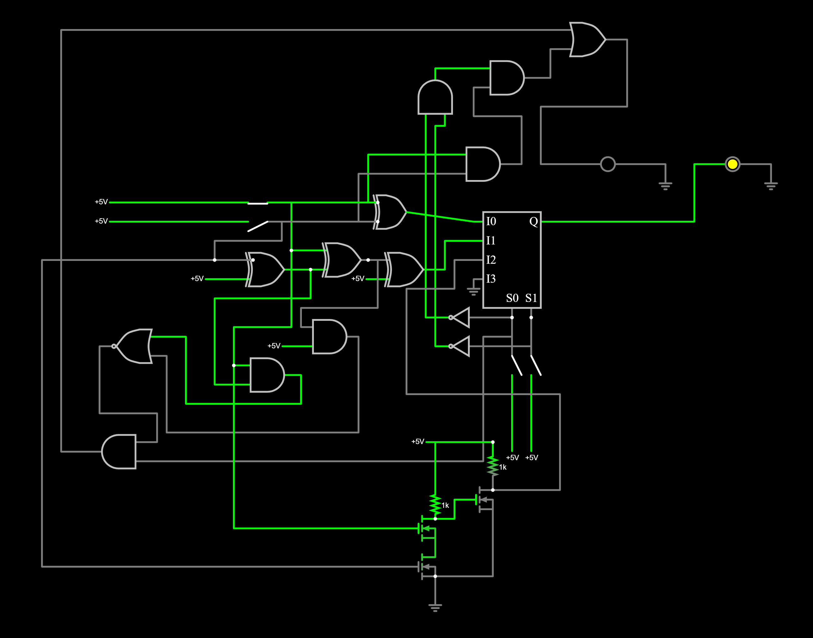
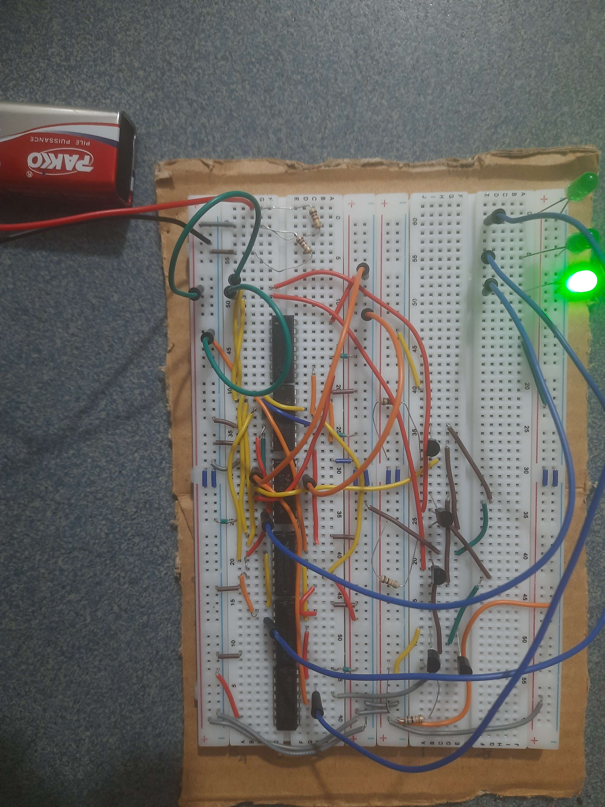

# ⚡ 1-Bit Arithmetic Logic Unit (ALU) Design & Implementation

This repository contains the design, simulation, and physical implementation of a 1-bit Arithmetic Logic Unit (ALU). Developed as a digital logic design project, this ALU is capable of performing core arithmetic and logic operations by integrating standard ICs with discrete transistor-level logic.

### 🔬 Project Overview
The ALU utilizes a 4:1 multiplexer (74153) controlled by two selection lines (S1S0) to dynamically route the results of four distinct operational blocks:
* **S1S0=00 (Addition):** Implemented via a full adder with Cin set to 0.
* **S1S0=01 (Subtraction):** Utilizes the full adder with one input inverted via XOR (1's complement) and Cin set to 1 to execute 2's complement subtraction.
* **S1S0=10 (Multiplication/AND):** Designed at the transistor level using series 2N7000 NMOS MOSFETs to form a NAND gate, followed by an NMOS inverter.
* **S1S0=11 (OR):** Constructed using parallel NMOS transistors (NOR configuration) routed through a 7404 NOT gate.

### 📐 Circuit Schematic & Physical Implementation

**Logic Schematic:**

**Breadboard Prototype:**

### 🛠️ Hardware Debugging & Engineering Challenges
During the physical breadboard implementation, several hardware constraints were addressed:
* **MOSFET Thresholding:** Transitioned to 2N7000 MOSFETs to ensure proper switching at 5V logic levels.
* **Signal Integrity:** Mitigated floating inputs and signal noise by implementing strategic pull-down and pull-up resistors at the NMOS gate inputs.
* **Visual Feedback:** Integrated LEDs to provide real-time verification of operational outputs, including dedicated carry and borrow states.

### 📄 Full Project Report
For a complete breakdown of the theoretical background, simulation results, and component mapping, please refer to the `Project_Report.pdf` included in this repository.
